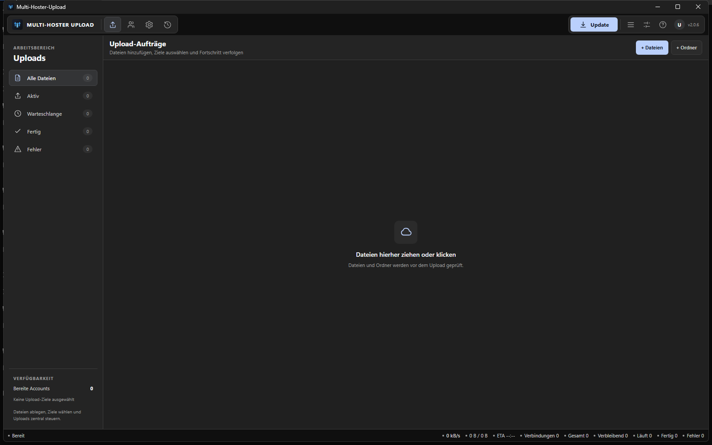
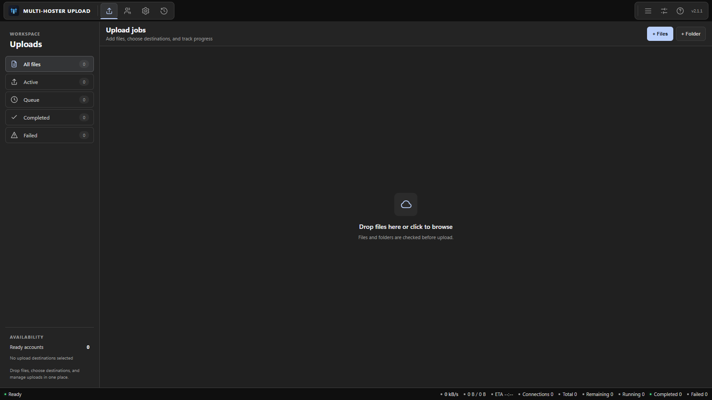
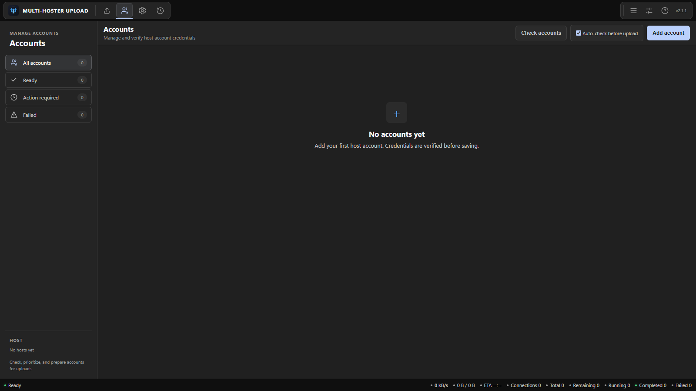
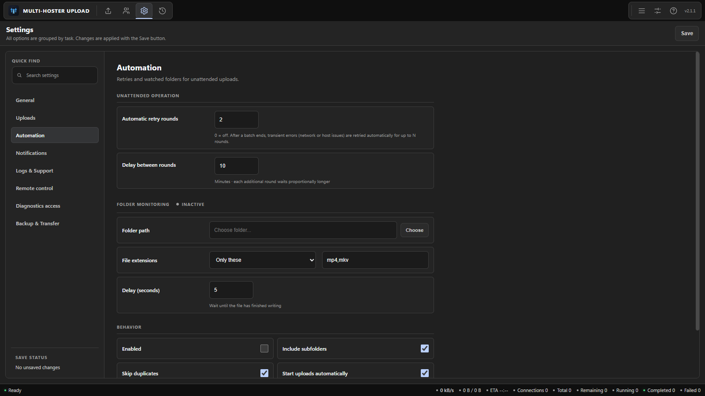
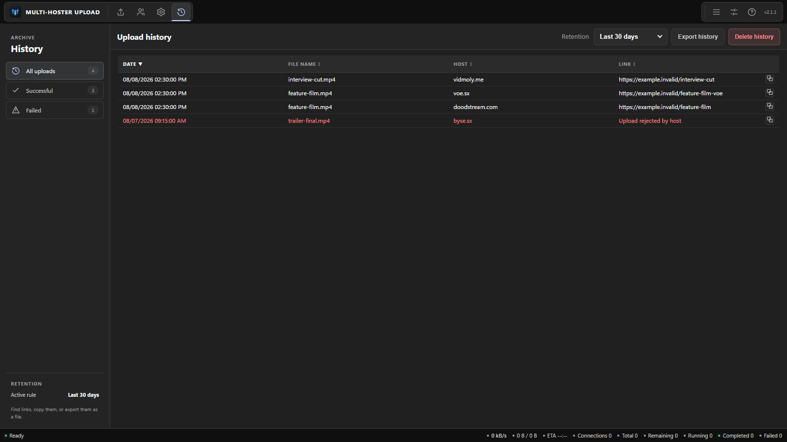

# Multi-Hoster-Upload

Multi-Hoster-Upload is a Windows desktop application for sending file batches to several supported video hosts from one queue. Add files or folders, choose one or more destinations, manage multiple accounts, and follow every upload from preparation to its final link.



## Download

Download the current Setup or Portable build from the [latest GitHub release](https://github.com/Sucukdeluxe/Multi-Hoster-Upload/releases/latest).

The latest public release is version 2.1.51. Use the release page for the executables and the full English changelog.

## Features

### Upload workspace

- Add individual files, complete folders, or files by drag and drop.
- Review candidates, duplicates, unavailable files, accepted files, destinations, resulting jobs, and configured size-limit omissions before confirming an import.
- Build one job per selected file and destination.
- Upload to several supported hosts from the same queue.
- Filter the workspace by all, active, queued, completed, or failed jobs.
- Search and filter queue entries by file name, host, and status.
- Open per-upload diagnostics with the selected account, retry count, and safe error details.
- Track status, smoothly interpolated progress, transferred size, speed, and the selected host account.
- Track the remaining upload size as queued and active files progress or return for a retry.
- Read total, remaining, running, completed, and failed upload activity from the persistent sidebar telemetry.
- Follow current upload speed in the sidebar and the synchronized header graph.
- Reorder selected jobs, start selected jobs, retry finished jobs, or stop active work.
- Copy completed links individually or together.
- Keep formatted link logs separate from source-cleanup and upload-plan audit records.

### Accounts and automation

- Keep multiple named accounts for each host.
- Validate credentials before a new or edited account is saved.
- Run health checks for one account or all configured accounts.
- Complete an OTP check in the account view when a host requests it.
- Enable, disable, prioritize, and reorder accounts.
- Rotate files across enabled accounts or keep the first enabled account as the primary account.
- Switch to an available fallback account when an account-specific upload error is detected.
- Apply retries, concurrency, bandwidth, file-size, and pacing settings per host.
- Monitor a folder for new files and start matching uploads automatically.

### History, transfer, and updates

- Restore unfinished queue entries after restarting the application.
- Keep upload history entries and filter the archive by all, successful, or failed views.
- Retain all history, a time window, or the latest 100 or 1,000 uploads.
- Export history as CSV or JSON.
- Export a per-session CSV or JSON report with host success rates, duration, bytes, attempts, and errors.
- Clearly mark interrupted uploads after a restart so they can be resumed deliberately.
- Use the complete interface in English or German and switch at runtime.
- Export settings locally or transfer them with an encrypted online backup key.
- Send a batch summary to a Discord webhook or another HTTP webhook.
- Check for application updates and read the matching GitHub release changelog in the update dialog.

## Supported hosts and authentication

| Host | Web login | API key |
| --- | :---: | :---: |
| Doodstream | Yes | Yes |
| VOE | Yes | Yes |
| Vidmoly | Yes | No |
| Byse | No | Yes |
| Clouddrop | No | Yes |

Doodstream uses the API key when an account contains both an API key and web-login credentials. VOE web login expects an email address. Only enabled accounts with the required credentials are available as upload destinations.

## Install or run portable

The release page contains two Windows builds:

- **Setup** installs the application for the current Windows user. It lets you choose the installation directory and can create a desktop shortcut.
- **Portable** runs directly without an installer. Move the executable wherever you want and launch it from there.

Both builds use the same application features. Portable refers to the executable package; application settings, queue state, and history still use Electron's user-data directory rather than a folder beside the executable.

## First upload



1. Open **Accounts** and select **Add account**.
2. Choose the host and authentication method shown in the table above.
3. Enter the credentials and select **Verify and add**. If the host requests an OTP, enter it before continuing.
4. Return to **Uploads** and add files, add a folder, or drop files into the workspace.
5. Select one or more available destinations. The application creates a queue preview for each file and host combination.
6. Review the jobs and start the complete queue or only the selected jobs.
7. Follow progress in the queue. Completed rows expose their generated links, which can be opened or copied.

Files and folders are checked before upload. A job can also be skipped by a configured maximum file size before any upload starts.

## Account management and rotation



Each host can contain several accounts. Accounts can have a label, can be enabled or disabled, and can be reordered within their host group. The first enabled account with usable credentials is the primary account.

Turn on **Rotate accounts** in a host's upload settings to distribute files round-robin across all enabled accounts for that host. With rotation off, the primary account remains selected. Rotation has no effect when only one usable account exists.

Account checks show ready, warning, OTP-required, checking, or failed states. An automatic check runs when the application starts, and checks can also be started manually for one account or all accounts. The application does not run a separate account check immediately before each upload batch. During a batch, account-specific failures can mark an account unavailable for that session and move work to a usable fallback. Transient network or host errors stay in the normal retry path instead of disabling the account.

## Queue, concurrency, rate controls, and recovery

### Concurrency and bandwidth

The application combines global controls with settings for each host:

- **Global parallel uploads:** `0` keeps only the per-host limits; `1` to `100` caps total concurrency across hosts.
- **Per-host parallel uploads:** limits simultaneous jobs for that host from `1` to `100`.
- **Global speed limit:** caps combined upload throughput in MB/s; `0` is unlimited.
- **Per-host speed limit:** caps that host's throughput in MB/s; `0` is unlimited.
- **Interval:** waits the configured number of seconds between jobs for a host.
- **Restart below:** restarts an upload when its measured speed remains below the configured kB/s threshold; `0` disables the check.
- **Maximum size:** skips files above the per-host MB limit; `0` is unlimited.

When automatic scaling is enabled and a global parallel limit is set, each per-host parallel limit is capped at that global limit. It does not distribute parallel slots across accounts.

### Retries and recovery

Each host has its own retry count. A job reports the retrying state while another attempt is being prepared. After a batch ends, optional automatic retry rounds can retry transient failures with a progressively longer delay.

Queue state is saved while you work and again during a normal application close. When **Restore queue at launch** is enabled, unfinished jobs return as ready queue entries after a restart. Start the restored jobs manually. Jobs that the upload log proves were already completed after the saved snapshot are removed from the restored queue to avoid an immediate duplicate.

Successful jobs can remain visible or be removed automatically. History is stored separately, so removing a completed row from the active queue does not remove its history entry.

### Permanent source cleanup

**Settings > Uploads** can permanently delete a source file after every destination selected for that file has completed successfully. This option is disabled by default and requires an explicit warning confirmation before it can be enabled.

Cleanup remains blocked while any required destination is unfinished, failed, canceled, skipped, or missing valid confirmation. The application records the original file identity, preserves successful destinations across retries and restarts, waits for active file handles to close, and refuses deletion if the source was replaced or modified. Every cleanup decision and result is written to the upload log. Deletion bypasses the Recycle Bin and cannot be undone.

## Folder monitoring



Folder monitoring watches for new files while the application is running. Configure it under **Settings > Automation**:

1. Choose the folder and decide whether subfolders are included.
2. Use an include or exclude extension list such as `mp4,mkv`.
3. Set a write-completion delay so partially copied files are not queued too early.
4. Choose whether duplicate file events are ignored during the current monitoring session.
5. Set the maximum automatic queue size. The default is `15,000` jobs; `0` means unlimited.
6. Select a reconciliation interval of 1, 5, 15, 30, or 60 minutes. The default is 5 minutes.
7. Select the destination hosts and decide whether matching jobs start automatically.
8. Enable monitoring and save the settings.

The status card summarizes the complete automation state. **Inactive** means monitoring is disabled or has no usable path. **Active** means monitoring is enabled and configured and no higher-priority paused, disconnected, error, or queue-limit state currently applies. **Paused** means the persistent manual pause is in effect. **Queue limit reached** means matching files are being deferred until capacity becomes available. **Folder disconnected** means the configured folder is currently missing or unreadable and will be checked again. **Error** reports another monitoring failure. The card also shows reachability, current queue use, today's counters, the latest detected file, reconciliation times, and the latest error when one exists.

**Test folder monitoring** performs a read-only full scan with the current folder, filter, subfolder, destination, size-limit, processed-file, and queue-limit rules. It reports aggregate counts without changing the queue, selected files, telemetry, history, logs, source files, settings, or the one-time existing-file option.

The automatic queue limit counts preview, queued, server-selection, uploading, and retrying jobs. Manual imports remain available and also consume queue capacity. Admission is file-atomic: all eligible destination jobs for one file are admitted together, or the complete file is deferred. A deferred file is reconsidered by a later reconciliation after capacity becomes available. Setting the limit to `0` disables this automatic backpressure.

New matching files are collected after they have remained stable for the configured delay. The optional one-time existing-file scan, live watcher events, interval scans, and reconnect scans use the same filtering and admission path. Reconciliation checks the complete folder at the selected interval. A missing folder keeps its configuration; after it becomes reachable again, exactly one reconnect scan runs before normal interval scans continue. If no hosts are preselected, the application asks for destinations instead of starting a batch automatically.

**Finish and pause** saves the pause before allowing active uploads to finish. While paused, no watcher, reconciliation, queued upload start, automatic start, or active-batch injection can proceed. Manual files can still be imported as preview jobs. The pause survives an application restart. **Resume** explicitly removes it, restarts monitoring, and performs one reconciliation without automatically starting existing preview jobs.

For automation decisions, **already processed** describes current evidence only: exact paths in the current queue, successful history results, and successful entries in the application's upload log. It is not a permanent file registry. A basename-only match is accepted only when it identifies one candidate unambiguously; same-named files from different folders remain eligible unless exact current evidence identifies them.

## History, retention, links, and export



History keeps completed, failed, stopped, and skipped results in a separate archive. Only a `done` result represents a successful upload; a `skipped` result records a job that was not uploaded. The current **Successful** view also includes skipped jobs even though they were not uploaded. Filter the archive by all, successful, or failed views; sort the table; open a generated link; or copy one link directly from its row.

Retention choices are:

- Keep everything.
- Keep the last 7, 30, or 90 days.
- Keep the latest 100 or 1,000 uploads.

Changing to a stricter rule previews how many rows will be removed and asks for confirmation. New history entries are pruned against the active rule. **Export history** saves the archive as CSV or JSON. Deleting history is permanent and requires confirmation.

## English and German

English is the default language for new profiles. Open **Settings > General** to switch between English and German. The visible interface updates immediately without restarting the application, including dynamically rendered lists, dialogs, status text, placeholders, titles, and accessibility labels. The selected language is saved for the next launch.

## Backup, security, and privacy

### Local data and credentials

Settings, pending queue state, and upload history are stored in Electron's user-data directory. Passwords and API keys must be encrypted with Electron `safeStorage` before they are written. On Windows, `safeStorage` uses DPAPI and ties encrypted values to the current Windows user profile. If operating-system encryption is unavailable or encryption fails, the write is rejected and credentials are never written as plaintext. Legacy plaintext credentials remain readable for migration and are encrypted during the next successful save.

Credentials are decrypted when required for account validation or upload to the selected host. Do not share application data files, backup files, screenshots containing credentials, or generated backup keys.

### Local backup

The Backup menu can export and import accounts and settings:

- `.mhu` uses an authenticated AES-256-GCM envelope with an app-wide built-in key. This detects modified or corrupted data and prevents accidental plaintext viewing, but it does not protect the backup from someone who has the application or its source code.
- `.json` is an explicit plaintext export. It can contain host credentials and must be protected accordingly.

Both backup formats can contain credentials. Protect `.mhu` files like credentials even though their contents are not directly readable as plaintext. Local backups exclude upload history and the pending queue. When importing on another computer, unavailable log or monitored-folder paths are cleared; folder monitoring is disabled if its saved path does not exist.

### Encrypted online transfer

Online backup is optional and transfers accounts and settings only. The application creates a 75-character key and encrypts the backup on the client with AES-256-GCM. New clients also encrypt the transfer key with the service operator's RSA-3072 public recovery key (OAEP-SHA256, bound to the record ID). The service stores only ciphertext and cannot decrypt backups by itself. Whoever holds the separate private recovery key and a stored record can recover its transfer key and contents. Queue state and history are not included.

#### Operator recovery setup

Before deploying the new client, run `node scripts/backup-recovery.cjs init <new-local-directory>` on a trusted local computer. Save `recovery-private.pem` separately in a password manager or encrypted offline storage. Do not put it on the backup server, in Git, or in support bundles. On Windows, use a private user directory with restricted inherited access permissions; POSIX file modes alone do not set Windows ACLs. Transfer only `recovery-public.pem` to the server and configure `RECOVERY_PUBLIC_KEY_FILE` with its absolute path. Deploy the updated backup service before the client. The client refuses new exports when the public key endpoint is unavailable or invalid; existing imports remain available. Older clients remain compatible but do not create recovery envelopes.

To recover a lost transfer key, obtain a read-only copy of the corresponding `<record-id>.json` file from the service's `BACKUP_DATA_DIR`, preserving the filename. Use SSH/admin access; there is deliberately no public backup-listing endpoint. If the ID was lost too, inspect record filenames, creation dates and expiry dates through that admin access. On the trusted local computer run `node scripts/backup-recovery.cjs recover <record-id>.json <recovery-private.pem> <new-output.txt>`. The tool verifies the ID, expiry, key fingerprint and encrypted payload, then writes the original transfer key to a new file without printing it. Import that key normally in the uploader. Protect and remove the temporary key file after use. Existing output files are never overwritten.

Recovery applies only to new records carrying recovery data. Old backups cannot be retroactively recovered without their original key. Expired or deleted backups are not recoverable through this workflow. Retain older private keys when rotating the public key; new keys cannot recover records encrypted for a previous key. No live data migration is required.

Backup service 2.0.6 records the creating connection's IP address alongside the creation time. It trusts forwarding headers only from configured proxy peers; the public proxy must overwrite or append the actual client address. The IP represents the observed connection (possibly a VPN/NAT exit), not a verified device identity. IP metadata shares the backup's retention and deletion lifecycle and is not returned by the public restore endpoint. The client stores the creation response's IP in its local key list and displays it next to the creation time. Older backups without this metadata show an unknown IP; historical addresses are not inferred.

Append `--details` to the offline recovery command to write `22.09.2026 - 14:30 | IP: 203.0.113.10 | MHU2-...` instead of only the key. Detailed timestamps use Europe/Berlin. Paste only the `MHU2-...` part into the uploader. Without the flag, the output remains directly importable. This IP extension is deployed with backup service 2.0.6 and supported by client 2.1.48. It introduces stored record version 4; the updated server still reads versions 1–3, but an older server cannot read new version-4 records. Do not roll back the server binary after creating such records without a data-preserving compatibility plan.

Treat the generated key like a password: anyone with it can restore the encrypted settings. Creating a new key does not invalidate older keys.

### Other network activity

- Uploads and credential checks communicate with the host you selected.
- Update checks retrieve release metadata, and the dialog loads the matching changelog from GitHub when available.
- Webhook notifications are sent only when you configure a webhook URL. Discord endpoints receive a formatted summary in the selected interface language; other endpoints receive JSON.
- Online backup traffic occurs only when you create or restore an online backup.

## Updates and changelog

Open **Settings > General** or **Help** and select **Check for updates**. When a newer version is available, the application shows the installed and available versions, download progress, and release notes. The update dialog requests the changelog for the matching version from the public GitHub release and uses the release's fallback description if that changelog is unavailable.

The downloaded Setup executable is checked as a Windows executable. When `latest.yml` contains a SHA-512 value, the downloaded file is also checked against it before installation starts.

You can always install manually from the [GitHub releases page](https://github.com/Sucukdeluxe/Multi-Hoster-Upload/releases).

## Troubleshooting

### No destination is available

- Open **Accounts** and confirm that at least one account is enabled.
- Check that its authentication method matches the supported-host table.
- Run the account check again and complete any requested OTP step.
- Add the account again if validation fails; invalid new credentials are not saved.

### The upload button stays disabled

- Add at least one file or folder.
- Select at least one host with an enabled account and usable credentials.
- Check whether a configured maximum file size skipped every preview job.

### Uploads retry or fail repeatedly

- Open the job log for the concrete host response.
- Recheck the account in **Accounts**.
- Reduce global or per-host concurrency.
- Review the per-host retry count, speed threshold, interval, and size limit.
- A low-speed restart reuploads the job; disable **Restart below** by setting it to `0` when it is not needed.

### A queue was interrupted

- Keep **Restore queue at launch** enabled before closing the application.
- Restart the application and review the restored ready jobs.
- Start those jobs manually after confirming the files still exist.
- Completed jobs may be removed automatically when they are already present in the upload log.

### Folder monitoring does not add a file

- Confirm that monitoring is enabled and the selected folder still exists.
- Check the status card for a persistent pause, a disconnected folder, an error, or a full automatic queue.
- Use **Test folder monitoring** to inspect the current read-only classification.
- Enable the one-time existing-file option when files already present at activation should be considered.
- Check the include or exclude extension list and the subfolder option.
- Wait for the configured write-completion delay.
- Confirm that at least one destination host is selected if automatic start is enabled.

### History or backup export does not appear

- History export is unavailable when the history is empty.
- Check the destination selected in the Windows save dialog.
- Both `.mhu` and `.json` backups can contain credentials. Protect either format like credentials.
- `.mhu` uses AES-256-GCM with an app-wide built-in key. It prevents direct plaintext viewing but does not protect the backup from someone who has the application or its source code. `.json` stores the same backup data as plaintext.
- Queue state and history are not part of settings backups.

### Update checking fails

- Check the internet connection and try again after active uploads finish.
- Use the [latest release page](https://github.com/Sucukdeluxe/Multi-Hoster-Upload/releases/latest) for a manual download.
- If the changelog cannot be loaded, the application can still show the fallback release description when one is available.

## Clouddrop log sync

Settings → Logs & Support includes an optional Clouddrop connection for upload logs. Enter an unrestricted Clouddrop API key and select **Verify and enable**. Verification creates an empty test file in a folder named after the device's public IP address; ipify provides the public IP. IPv4 is preferred, with readable IPv6 as a fallback. The key is stored using the operating system's credential encryption. Multiple instances can use the same key; each writes its own files, including when instances share a public IP.

New successful upload entries for hosts with file logging enabled are synchronized automatically as TXT files. The single-file, daily and per-session log modes apply. Files have unique suffixes so separate instances using the same key do not overwrite one another. Large logs are split into separate files before they reach the text API size limit. Existing local log contents are not imported automatically.

The panel shows the connection state, IP folder, last successful sync and pending files. Changes are queued locally, retried after connection failures and resumed after restarting the application. Disabling sync retains pending entries but stops collecting new ones. A revoked key requires verification with a valid key. Local pending data is tied to its Clouddrop account and is never sent to another account after changing keys.

## MCP remote access

Settings → Remote control provides an optional structured MCP connection. Assign an installation name, select local permissions and choose **Save and enable**. The application connects to its HTTPS relay using outbound long polling; it does not open an incoming desktop port. Keep the application running, including minimized, while using this connection.

Copy the connection code only when configuring a trusted MCP client. It contains a credential. Each installation has separate encrypted credentials outside settings backups. **Disable and revoke** stops local execution immediately and revokes the credentials at the relay; an offline revocation remains pending until contact is restored. **Rotate access** invalidates the previous identity and creates a new code. Importing a settings backup does not import another installation's MCP identity.

Permissions are configured locally, never through remote tools:

- **Read and diagnostics:** application state, paginated queue/accounts/history, settings with secrets masked, and bounded application-log tails.
- **Control app:** explicit queue, account, settings, automation, CloudDrop, backup and lifecycle operations. There is no generic script, shell or IPC execution tool.
- **Granted directories:** list, inspect and checksum files only inside explicitly selected directories. Queue additions also require control permission. File deletion additionally requires a writable directory grant, control permission and local confirmation; it uses the operating system's trash operation.
- **Explicitly reveal secrets:** separately enabled access to a specifically requested account's credentials. Normal diagnostics and other tool responses remain masked.

Destructive operations require a native local confirmation for the exact action and arguments. Cancel is the default, approval expires within 60 seconds, and no remote tool or boolean can grant it. Starting transfers also requires confirmation when current settings enable automatic source deletion or power actions. Cancellation and expiry prevent pending actions from starting; they cannot undo an action already committed.

MCP replaces both legacy remote listeners. The old screen/input and diagnostic servers no longer start, their activation controls are removed, and settings imports cannot reactivate them. A compatible Streamable HTTP client must be configured separately. Local support-package export remains available without MCP.

The previous diagnostic operations map to these MCP tools:

| Previous operation | MCP replacement |
| --- | --- |
| System information and server health | `mhu_diagnostics_summary` |
| Redacted configuration | `mhu_settings_get`, `mhu_accounts_list` |
| Log list, read and tail | `mhu_logs_list`, `mhu_logs_read` |
| Application events | `mhu_app_events` |
| Classified errors | `mhu_errors` |
| Queue snapshot | `mhu_app_state`, `mhu_queue_list` with current renderer state |
| History and hoster statistics | `mhu_history_list`, `mhu_history_summary` |
| Rotation state and configured hosters | `mhu_diagnostics_summary`; `mhu_accounts_check` for explicit live checks |

Screen streaming and arbitrary mouse/keyboard control are intentionally not MCP operations. CAPTCHA and interactive authentication challenges remain local; supported one-time account codes can be submitted with `mhu_accounts_otp`. Granting new directories, changing MCP permissions and obtaining the connection code are local security decisions. These boundaries do not disable ordinary upload, queue, account, automation, history or backup operations exposed through the structured tool catalog.

### Official updates and performance monitoring

The separate **Allow official app updates without another confirmation** permission is disabled by default. Enabling it requires local confirmation. It only authorizes the application's official Windows installer workflow, not shell commands, arbitrary downloads, deletions or backup restores. Portable and unpacked installations are rejected by this remote workflow.

`mhu_update_install` requires an exact `targetVersion` and an idempotency `requestKey`. The selected official release must match that version. The installer is streamed to a private temporary directory, checked against the release's SHA-512 metadata and checked again from disk before launch. Use `mhu_update_status` to query the persistent job. A repeated key returns the same job, and cannot be reused for a different version.

The update first saves its resume intent, stops new admission and waits for currently active uploads to finish. It does not interrupt a multipart upload and pretend it can resume from a byte offset. Queue persistence and the normal close handshake must succeed before the installer is launched and the application exits. After restarting, the job completes only when the exact target version is running, MCP has reconnected and the previously running work has been restored. A missing restart, wrong version, revoked permission or persistence failure is not reported as success. The first release containing this workflow must be installed through the existing local updater before remote updates can be used.

`mhu_performance_get` is read-only and returns bounded in-memory samples of main-thread timer delay, renderer round trips, CPU usage, process memory, asynchronous file-I/O waits and upload-slot occupancy. It does not launch host commands. A slow network request, provider wait or asynchronous disk operation is not itself a main-thread freeze. Long timer gaps are reported as measurement gaps, not proven freezes. Historical samples cover only the current process and their bounded retention window.

`mhu_system_metrics` provides separate system-wide CPU and RAM measurements, process CPU/RAM, Windows physical-disk read/write throughput, IOPS, activity, queue lengths, cumulative byte counters and volume capacity. Sampling runs every ten seconds while MCP is enabled. Windows storage counters are collected asynchronously through a fixed, hidden, timeout-limited system query; the tool itself only reads the cache. Use `limit` (1–60) for recent samples. Large responses are truncated with an explicit flag. Initial rates are `null` until two valid samples exist; failed queries retain the last storage sample with `available: false` and `stale: true`. Cumulative byte totals are decimal strings to preserve integer precision. Storage metrics cover the whole machine, not just uploader I/O; the `_Total` activity counter is an aggregate, not the busiest disk.

Use `mhu_capabilities` to inspect effective permissions and available actions before controlling an installation. `mhu_automation_pause` and `mhu_automation_resume` explicitly control the shared upload/automation pause; their queue equivalents remain supported. Resuming does not enable a disabled monitor. `mhu_automation_start` enables configured monitoring and returns `AUTOMATION_PAUSED` if the shared pause must first be resumed. Failed lifecycle operations return an MCP error, not a successful response containing an error string. A read-only status check never changes the pause state.

Structured settings updates also support upload parallelism scaling, partial filename-scrambling settings, history retention and hoster size-limit memory. Enabling automatic source deletion, a completion power action or limited history retention requires exact local confirmation. `mhu_shutdown_cancel` cancels the pending completion action immediately, then saves `nothing` as the policy. This does not authorize immediate system shutdown or unrestricted operating-system control.

The upload scheduler no longer reserves a global transfer slot while waiting for a hoster's configured start interval. Per-hoster spacing remains enforced at admission. Upload file metadata and chunk reads use asynchronous I/O. These changes do not reduce configured parallelism or change successful-upload confirmation requirements. Synthetic benchmark results demonstrate the targeted scheduling case only; server-specific throughput and freeze improvements require measurements after installing the new version.

### Diagnostic artifacts and file transfer

`mhu_diagnostics_files` lists the application's startup journals, native Chromium logs and automatically saved startup failure reports. `mhu_diagnostics_read` reads one listed artifact with bounded pagination. Credentials are filtered from the complete text before pages are returned; offsets refer to characters in the filtered text. Files larger than 8 MiB are rejected by this reader. The existing bounded log-tail tools remain available for larger application logs. Job-specific logs, account cooldowns and manual-action states are exposed through `mhu_queue_job_log` and `mhu_accounts_runtime`; the diagnostic summary also includes current upload-manager and renderer status.

Full file transfer needs both read and directory permissions, plus an additional local **Transfer file contents** approval for the selected directory. Existing grants do not acquire this approval automatically. Transferring a file does not require deletion permission and never changes the source. Application credential storage and hard-linked files cannot be exported through this channel. A granted user file may itself contain private information; approve only directories whose contents may be transferred.

Use `mhu_files_transfer_open` to prepare a specific file inside an approved directory, then `mhu_files_transfer_get` until the state is `ready`. The result includes its size, SHA-256 and a token-free `media-mcp-file:v1:` reference. That reference identifies the transfer but grants no access by itself: the receiver also needs the installation's separate connection code. `mhu_files_transfer_read` supplies checked chunks to the receiver; do not paste binary chunks into a chat. `mhu_files_transfer_list` and `mhu_files_transfer_close` inspect or close the current client's handles. Transfers are limited to four at once, 32 GiB per file, one-MiB chunks, a one-hour absolute lifetime and ten minutes without activity. Removing the grant, changing local permissions or disabling access invalidates open transfers.

On the receiving computer, install the development dependencies and keep the connection code in a private local file outside Git. The receiver uses only the fixed HTTPS relay, refuses redirects and does not send files to arbitrary URLs:

```powershell
node scripts/pull-mcp-file.mjs <private-code-file> <rootId> <relativePath> <destination>
node scripts/pull-mcp-file.mjs <private-code-file> --transfer <file-reference> <destination>
```

The receiver writes an exclusive `.mcp-part` file and a resumable checkpoint without credentials. It verifies each block, rechecks the complete file from disk, and checks size and SHA-256 before publishing the destination without overwriting an existing file. Add `--resume` to continue an interrupted transfer; the saved prefix and source identity are checked again. An expired transfer can be reopened when the original directory and relative path are supplied. Incomplete files stay available for recovery after a failure. Neither the original file nor an existing destination is deleted.

After a hard process termination, a `.mcp-lock` file may remain. Remove only that exact lock after confirming that no receiver is still running for the destination, then retry with `--resume`. Preserve the partial file and checkpoint. The receiver does not automatically remove an unknown or potentially active lock.

## Development and Windows builds

Install dependencies and start the Electron application:

```powershell
npm install
npm start
```

Run the public lint and dependency checks:

```powershell
npm run verify
```

The regression suite is maintained and executed in a separate private repository against an exact application commit. Public CI runs lint, dependency checks and Windows builds; it does not run the private tests. Maintainers must also verify the private regression run before releasing. Historical commits and release tags have not been rewritten.

Create both Windows release targets without publishing them:

```powershell
npm run release:win
```

The release command builds the NSIS Setup executable and the Portable executable into `release/`.
